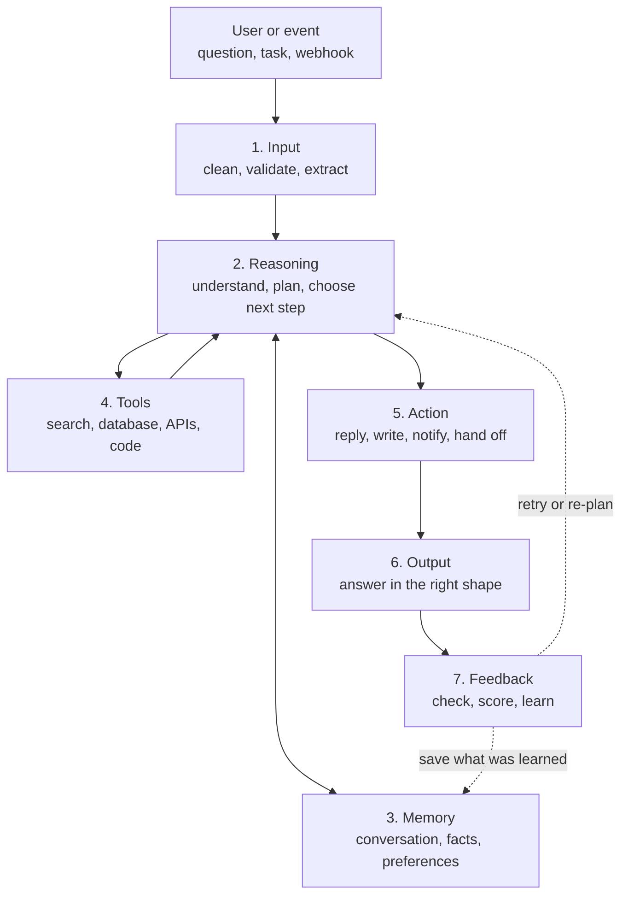
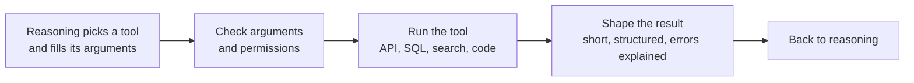
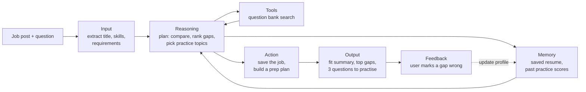

# Agent architecture, layer by layer

*Last reviewed: October 2026*

An AI agent is a program that takes a goal, decides what to do, uses tools
and data to do it, and checks the result. Every agent you will build or be
asked about in an interview has the same seven parts. This page walks through
them in the order a request flows, then shows how to design a small agent
from scratch.

!!! tip "How to use this page"
    Read the big picture first, then one layer at a time. For each layer, say
    the "In one line" sentence out loud and answer its interview question
    without looking. Then try the full design exercise at the end. In the
    [OfferReady app](https://getofferready.app/practice/bank) the Agents topic
    has the same questions with scored practice.

<!-- RELATED-MODULE -->

## The big picture

Two things make this an agent rather than a single model call:

- **The loop.** Reasoning can call a tool, read the result and decide again,
  several times, before it acts. A plain chatbot answers once.
- **Feedback.** The result is checked (by code, a second model or the user),
  and a failed check sends the agent back to reasoning instead of to the user.

In the code, the "layers" are rarely separate services. In a small agent they
are a few functions around one model. The value of naming them is that each
one has its own design choices and its own ways of failing, and interviewers
probe them one at a time.

| Layer | Its job | Typical building blocks |
|---|---|---|
| Input | Turn raw input into something the agent can reason about | Parsing, schema validation, PII masking, file and speech to text |
| Reasoning | Decide what to do next | An LLM with a system prompt, a planner, routing rules |
| Memory | Keep what the agent needs beyond this one call | Message history, summaries, a vector store, a profile table |
| Tools | Reach data and systems outside the model | Function calling, MCP servers, REST APIs, SQL, code execution |
| Action | Do the chosen step | Reply, write to a system, send a notification, call another agent |
| Output | Present the result | Structured JSON, formatted text, citations, UI cards |
| Feedback | Check the result and improve | Validators, evals, LLM judges, user ratings, retries |

## 1. Input layer

**In one line:** it takes whatever arrives (text, a file, an API payload, an
event) and turns it into clean, checked input for reasoning.

What it does:

- **Normalizes formats.** PDF and images to text (OCR), speech to text, JSON
  payloads to typed fields.
- **Validates.** Required fields present, sizes within limits, types correct.
  It rejects what the agent can't handle with a clear message, instead of
  letting the model guess.
- **Protects.** Masks personal data it shouldn't keep, and marks any text
  that came from outside (a web page, an email, a document) as data, not
  instructions. That is the first defence against prompt injection.
- **Extracts.** Pulls out the parts reasoning needs: the intent, the IDs, the
  dates.

Common mistakes: passing a 200-page PDF straight into the prompt, trusting
fields from an outside system without checking them, and treating instructions
found inside an uploaded document as if the user had typed them.

!!! question "Interview question"
    A user uploads a PDF contract and asks the agent to summarize the
    termination terms. What should the input layer do before the model sees
    anything?

    *Strong answer:* extract the text (OCR if it's scanned), check size and
    type, split it into sections, mask personal data that isn't needed, and
    pass only the relevant sections forward, labelled as document content so
    that any instructions inside the document are not followed.

## 2. Reasoning layer

**In one line:** the decision-maker. It works out what is being asked, breaks
it into steps, and decides whether it can answer now or needs memory or a tool
first.

How it is usually built:

- **One model call per step,** with a system prompt that states the goal, the
  rules and the tools available. The model returns either a tool call or a
  final answer.
- **A pattern for the loop.** ReAct (think, act, observe, repeat) when each
  step depends on the last result. Plan-and-execute (make the whole plan,
  then run it) when the steps are predictable. A router when requests fall
  into a few clear types. The [deep dive](../agent-principles/index.md#part-2-patterns)
  compares them.
- **Limits.** A maximum number of steps, a time budget and a cost budget, so
  that a confused agent stops instead of looping.

Common mistakes: no step limit, one huge prompt that tries to do everything,
using a model call for a decision a simple rule could make, and letting the
model "remember" facts it should look up.

!!! question "Interview question"
    Your agent sometimes calls the same search tool five times in a row with
    almost the same query. What is going wrong and how do you fix it?

    *Strong answer:* reasoning isn't using the observations, usually because
    the tool results are too long or poorly formatted, or the prompt doesn't
    say what "enough information" looks like. Fix the tool output (short,
    structured, with a clear "no results" case), add a step limit and a
    repeated-call check, and state the stopping condition in the prompt.

## 3. Memory layer

**In one line:** what the agent keeps beyond a single model call, so it
doesn't start from zero every time.

| Kind | Holds | Lives in | Example |
|---|---|---|---|
| Working (short-term) | This conversation or task: recent messages, tool results, the plan | The context window, trimmed or summarized | "The user already said the order number" |
| Long-term facts | Knowledge the agent can look up | A vector store or database, retrieved per question | Product docs, past tickets |
| Profile | Stable facts about the user | A table keyed by user | Preferred language, time zone |
| Episodic | What happened in past tasks and how they went | Logs, summaries | "Last refund for this customer was approved" |

Design choices that matter:

- **Read on demand.** Retrieve only what this step needs. Stuffing everything
  into the prompt costs money and makes answers worse.
- **Write on purpose.** Decide what is worth saving and when, and who can see
  it. Saving everything turns memory into noise and a privacy risk.
- **Expire and correct.** Facts go stale. Give memories a source and a date,
  and let users fix or delete them.

Common mistakes: keeping the whole chat history forever until it overflows,
saving content from untrusted sources as if it were fact (memory poisoning),
and sharing memory across users by accident.

!!! question "Interview question"
    How would you give a support agent memory across conversations without
    leaking one customer's data to another?

    *Strong answer:* store long-term memory per customer, keyed and filtered
    by the authenticated customer ID on every read and write (enforced in the
    data layer, not by the prompt), save only summaries and facts with a source
    and date, and expire or let the customer delete them.

## 4. Tool layer

**In one line:** the agent's hands. Tools let it fetch live data and change
things in other systems, which the model alone cannot do.

How a tool call works:

What makes tools reliable:

- **A clear contract.** A specific name, a one-line description of when to use
  it, typed arguments, and a result format the model can read. Most tool
  mistakes are really description mistakes.
- **Few, focused tools.** Five well-defined tools beat thirty overlapping ones.
- **Separate reads from writes.** Reading data can be automatic. Writing,
  paying, deleting or emailing should need narrower permissions and often a
  human's approval.
- **Errors the model can act on.** "Customer not found: check the ID format
  (C-12345)" leads to a fix. A stack trace leads to a guess.
- **Standard connections.** MCP gives agents one way to plug into many tools.
  See [MCP](../mcp/index.md).

Common mistakes: vague tool descriptions, returning huge raw payloads, no
timeouts or retries, and giving the agent a tool that can do more than the
task needs.

!!! question "Interview question"
    Your agent needs to look up orders and also issue refunds. How do you
    design those two tools differently?

    *Strong answer:* order lookup is read-only, cheap and can run freely.
    Refund is a write with money attached: it takes the order ID and amount
    as typed arguments, checks policy limits in code (not in the prompt), is
    idempotent so a retry can't refund twice, logs who and why, and above a
    threshold returns "needs approval" for a human instead of acting.

## 5. Action layer

**In one line:** where a decision becomes something real: a reply, a record
written, a message sent, a workflow started, a hand-off to another agent or
a person.

Kinds of action, from safest to riskiest:

1. **Reply** to the user with an answer or a question.
2. **Draft** something for a person to approve (an email, a pull request).
3. **Write** inside a system the agent owns (a note, a status).
4. **Change** something that matters elsewhere (a refund, a deployment, a
   message to a customer).

The further down that list, the more you need: confirmation from a person,
an audit log, a way to undo, and limits on how often it can happen.

Common mistakes: acting when the agent should have asked a clarifying
question, no record of what was done, and actions that can't be undone
without a person in the loop.

!!! question "Interview question"
    When should an agent ask the user a question instead of acting?

    *Strong answer:* when the request is ambiguous and a wrong guess is costly
    or hard to undo (sending, paying, deleting), when required information is
    missing, or when confidence is low. For cheap, reversible steps it should
    act and say what it assumed.

## 6. Output layer

**In one line:** it shapes the result for whoever receives it: a person, a
UI, or another program.

- **For programs:** structured output (JSON matching a schema), validated
  before it is passed on. Most model APIs can enforce a schema.
- **For people:** clear, short, with sources when facts came from tools or
  documents, and an honest "I couldn't find that" instead of an invented
  answer.
- **For other agents:** a summary of what was done and what is left, not the
  whole transcript.

Common mistakes: free text where a program expects fields, answers without
sources, and hiding uncertainty.

## 7. Feedback layer

**In one line:** it checks the result and turns the outcome into
improvement, right now (retry, fix) and over time (better prompts, tools and
memory).

Where feedback comes from:

| Source | Example | What it changes |
|---|---|---|
| Code checks | Schema valid? SQL ran? Numbers add up? | Retry this step, or re-plan |
| A second model (judge) | "Does the answer cite the policy it used?" | Revise before showing the user |
| The user | Thumbs down, a correction, "that's not what I meant" | This conversation, and memory if it's a lasting preference |
| Evals over time | A test set of real tasks, run on every change | Prompts, tools and model choice |

Rules that keep feedback useful:

- **Cap retries.** Two or three, with a changed approach each time, then a
  clear message or a hand-off to a person.
- **Prefer checks you can run in code** over a model's opinion of itself.
- **Close the loop offline.** Collect failures, add them to an eval set, and
  fix the cause (a tool description, a missing tool, a prompt rule).
  See [Observability & Eval](../observability/index.md).

!!! question "Interview question"
    How do you know your agent got better after a prompt change?

    *Strong answer:* run a fixed eval set of real tasks before and after,
    measuring task success, tool-call accuracy, cost and latency, plus a few
    safety cases, and only ship if success goes up without regressions.

## Worked example: a job-application helper agent

A user pastes a job post and asks: "Am I a fit, and what should I prepare?"

1. **Input** pulls the title, required skills and seniority from the post and
   rejects anything that isn't a job description.
2. **Reasoning** plans three steps: compare the requirements with the resume,
   rank the gaps, choose practice topics.
3. **Memory** supplies the saved resume and past practice scores, so it
   doesn't ask again.
4. **Tools** search the question bank for questions on the top gaps.
5. **Action** saves the job and a day-by-day prep plan.
6. **Output** gives a short fit summary, the top gaps with the evidence for
   each, and three questions to practise.
7. **Feedback:** the user says "I do have Kafka experience, it's just not on
   my resume". The agent updates its view for this job, and suggests adding
   that experience to the resume rather than claiming it for them.

## Design a basic agent in seven steps

Use this order in a design interview or when you build your first one.

1. **Write the task in one sentence, with what "done" means.** "Answer billing
   questions from the policy docs, with a citation, or hand off to a person."
2. **List the inputs and their limits.** Text only? Files? Maximum size?
3. **Pick the reasoning pattern and the limits.** Router, ReAct or
   plan-and-execute; maximum steps, time and cost.
4. **Decide what memory is needed, and nothing more.** Often just the
   conversation plus document retrieval.
5. **Define the smallest set of tools.** Separate reads from writes, and
   decide which actions need approval.
6. **Specify the output format** for each consumer, and the "I don't know"
   path.
7. **Plan feedback before launch.** Code checks, a retry cap, an eval set of
   20 to 50 real tasks, and tracing so you can see each step.
   See [Agentic AI in 7 diagrams](../agent-diagrams/index.md) for evals and tracing.

## Quick check

??? question "Name the seven layers in order and say what each one does in a few words."
    Input (clean and check what comes in), reasoning (decide the next step),
    memory (keep context beyond one call), tools (reach outside data and
    systems), action (do the step), output (shape the result), feedback
    (check it and improve).

??? question "What separates an agent from a single LLM call?"
    A loop and feedback: it can call tools, read the results and decide again
    before answering, and its result is checked, with a failed check sending
    it back to reasoning.

??? question "Why should writes and reads be separate tools?"
    So reads can run freely while writes get narrower permissions, policy
    checks in code, idempotency, logging and human approval where the
    consequence is high.

??? question "Where is the first defence against prompt injection?"
    The input layer: content from outside (documents, web pages, emails, tool
    results) is labelled and handled as data, never as instructions. Tool
    permissions and approval on writes limit the damage if it gets through.

## Go deeper

- [Agent Engineering](../agent-engineering/index.md): the survey, with interview scenarios.
- [Building Agents: principles and patterns](../agent-principles/index.md): ReAct, plan-and-execute, reflection, routers and multi-agent, with trade-offs.
- [Context Engineering](../context-engineering/index.md): what goes into the window and why.
- [LangGraph](../langgraph/index.md): building the loop as a graph.
- [Agentic AI in 7 diagrams](../agent-diagrams/index.md): harness, context, tools, memory, guardrails, evals and tracing.
