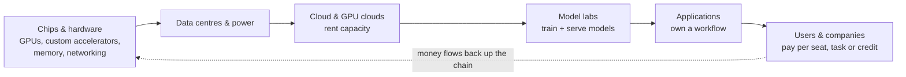
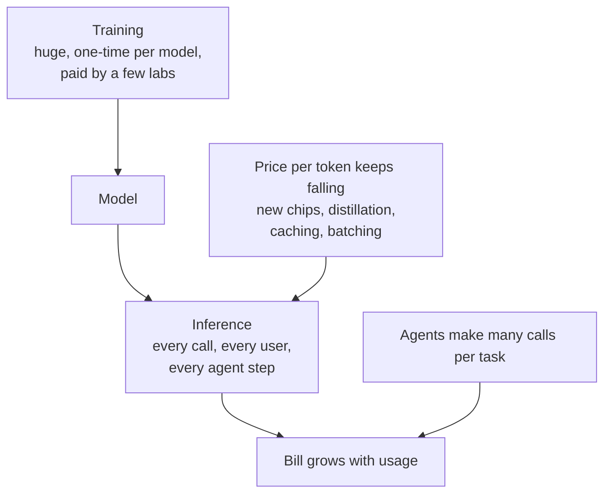
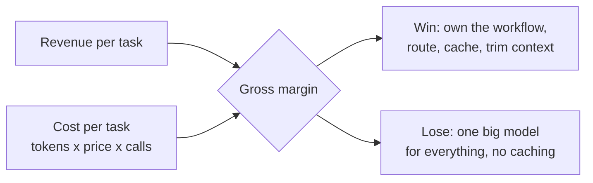

# AI economics in 2026

*Last reviewed: October 2026. Prices and market shares move fast: check
current figures before you quote a number in an interview.*

AI has moved from the **experiment era** (does it work?) to the **economics
era** (does it pay for itself?). Senior interviews now ask about this
directly: what a feature costs per task, who captures the margin, and how
you'd cut the bill without hurting quality.

## The value chain: who gets paid

Every request a user makes pays every layer to its left. That is why the
layers closest to the hardware have been the most certain winners so far.

| Layer | How it makes money | Main risk |
|---|---|---|
| **Chips & hardware** | Every lab and cloud must buy compute first | Customers designing their own chips; supply and export limits |
| **Data centres & power** | Long contracts for space, cooling and electricity | Power and grid limits; build-out ahead of demand |
| **Clouds & GPU clouds** | Margin on renting capacity and managed services | Price competition; utilisation |
| **Model labs** | API usage and subscriptions | Huge training and serving costs; prices fall as rivals catch up |
| **Applications** | Price on the value of a finished job | Thin wrappers get squeezed between model prices and user expectations |

## Training is a one-off. Inference is the bill that grows.

Two forces pull against each other:

- **Unit price falls.** Newer chips, smaller distilled models, quantisation,
  batching and prompt caching make the same quality cheaper every year.
- **Usage grows faster.** Agents call the model many times per task, use
  long contexts and retry. Cheaper tokens invite more of them (a version of
  the Jevons paradox), so total spend keeps rising.

**The number that matters is cost per completed task**, not cost per token.
A cheaper model that needs three retries can cost more than a stronger one
that gets it right first time.

## Where an application's margin comes from

1. **Route by difficulty.** Small, fast models for classification,
   extraction and formatting; the strongest model only where it changes the
   outcome.
2. **Cache.** Reuse long, repeated prompt prefixes and identical answers.
3. **Trim context.** Send what the step needs, not the whole history (see
   [Context Engineering](../context-engineering/index.md)).
4. **Cap the loop.** Limit agent steps and retries; stop early when done.
5. **Batch** work that isn't urgent, at lower prices.
6. **Price on outcomes.** Charge per finished task or credit, and only when
   it succeeds, so cost and price move together.

Deeper: [Cost Optimization](../cost-optimization/index.md) ·
[LLMOps](../llmops/index.md)

## Who wins

- **Most certain:** the suppliers every competitor must pay (hardware,
  power, cloud capacity), as long as demand keeps growing.
- **Contested:** model labs. Revenue is large, but so are costs, and prices
  fall as rivals and open-weight models catch up. Staying at the frontier
  and selling to enterprises is the bet.
- **Durable apps:** products that own a painful workflow, hold their own
  data and context, and run a disciplined cost per task.
- **Squeezed:** thin wrappers with no workflow, data or cost control. Their
  price drifts down toward the model's price.

## How interviewers probe this

**"Your feature costs too much. What do you do first?"**
Measure cost per completed task by step, from traces. Then route easy steps
to a smaller model, cache repeated prefixes, trim context and cap retries.
Re-run your evals after each change to prove quality held.

**"Should we fine-tune a small model or call a frontier model?"**
Compare total cost per task at your volume: fine-tuning and hosting cost vs
API calls, plus quality on your eval set and the team's ability to maintain
it. High volume, narrow task and stable inputs favour the small model.

**"Self-host open-weight models or use an API?"**
Self-hosting wins at high, steady utilisation and when data must stay
inside; APIs win on speed to ship, spiky traffic and access to the best
models. Include GPU idle time, on-call and upgrades in the self-host cost.

**"Prices per token keep falling. Why is our AI bill still going up?"**
Usage grows faster than prices fall: more users, agents with more steps,
longer contexts. Track cost per task and per user, not per token.

**"Where would you build a company in this market?"**
Name a layer and its moat: a workflow you own, data others don't have, or a
cost advantage you can keep. Say who you'd be squeezed by and why you'd
survive it.
