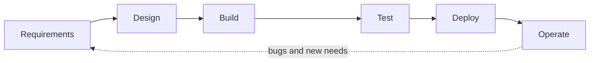
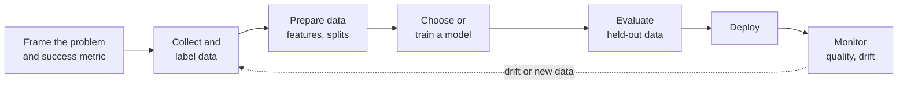
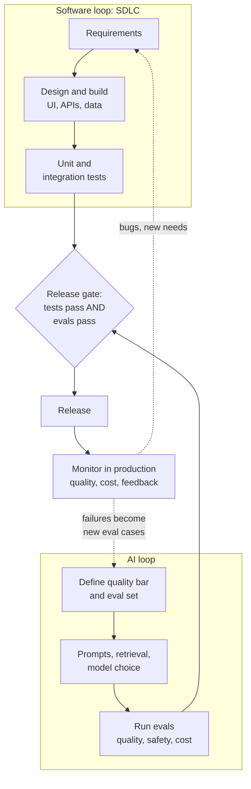

# SDLC vs AI development lifecycle

*Last reviewed: October 2026*

Interviewers for AI engineer, forward deployed and architect roles often ask
how building an AI feature differs from building normal software. The short
answer: it depends on what you are building.

| You are building | Lifecycle | What decides "done" |
|---|---|---|
| **Traditional application** (a billing system, a REST API, a dashboard) | **SDLC**: software development lifecycle | Tests pass. The same input always gives the same output. |
| **AI application** (a fraud model, a recommender, a fine-tuned model) | **AI development lifecycle** (sometimes shortened to AIDLC) | Quality metrics on held-out data are good enough, and stay good in production. |
| **AI-powered application** (a product with an LLM feature, a RAG assistant, an agent) | **SDLC + AI lifecycle together** | Both: the software works *and* the AI part meets its quality, safety, cost and latency targets. |

Most AI engineer jobs today are the third kind, which is why interviewers want
to hear that you can run both loops at once.

!!! note "Two meanings of “AIDLC”"
    The term isn't standardized. Most people mean the lifecycle of building an
    AI system (this page). Some vendors use **AI-DLC** for the *AI-driven*
    development lifecycle: using AI coding assistants and agents to build
    ordinary software. If an interviewer says "AIDLC", it's fine to ask which
    one they mean; that question itself shows you know the field.

<!-- RELATED-MODULE -->

## 1. Traditional applications: the SDLC

- **Logic is written by people.** Behaviour is in the code, so it can be read,
  reviewed and reasoned about.
- **Deterministic.** The same input gives the same output, so unit and
  integration tests give a clear pass or fail.
- **Change comes from the team.** The system only changes when someone ships
  new code. Monitoring watches uptime, errors and latency.
- **Methods:** agile, CI/CD, code review, versioned releases, rollback.

## 2. AI applications: the AI development lifecycle

- **Behaviour is learned from data.** You can't read the logic; you measure it.
  Data quality decides model quality.
- **Probabilistic.** Results are right some percentage of the time. "Done"
  means a metric (precision, recall, accuracy, a business KPI) passes an agreed
  bar on data the model hasn't seen.
- **It degrades without code changes.** The world changes (data drift, concept
  drift), so a model that was good at launch gets worse. Monitoring watches
  prediction quality and input distributions, not just uptime.
- **Retraining is part of the plan,** with versioned data, models and
  experiments so any result can be reproduced.
- **Extra concerns:** labelling cost, bias and fairness, explainability, and
  privacy of training data.

## 3. AI-powered applications: both loops together

An AI-powered app is ordinary software (UI, APIs, auth, databases, billing)
with one or more AI components inside (an LLM call, retrieval, an agent).
The software follows the SDLC; the AI component follows its own loop, and the
two meet at release time.

What changes compared with plain SDLC:

| Phase | Traditional app | AI-powered app adds |
|---|---|---|
| Requirements | Features and acceptance criteria | A quality bar for the AI part (for example "90% of answers grounded in the cited document"), what it must never do, and cost and latency budgets |
| Design | Components, APIs, data model | Where the model sits, retrieval and context design, tools, guardrails, a human hand-off path, a fallback when the model fails |
| Build | Code | Prompts, retrieval pipelines and tool definitions, versioned like code |
| Test | Unit and integration tests | An **eval set** of real tasks scored automatically (code checks, LLM judges, human review), plus safety and prompt-injection cases |
| Release | CI/CD, feature flags | A release gate on evals as well as tests, staged rollout, model and prompt versions pinned |
| Operate | Uptime, errors, latency | Answer quality, hallucination and refusal rates, cost per request, user feedback, drift when the model provider updates a model |
| Improve | Bug fixes, new features | Failures become new eval cases; prompts, retrieval or model are changed and re-evaluated before shipping |

The habits that matter most in interviews:

1. **Evals are the tests of the AI part.** No eval set, no way to know if a
   change helped. Start with 20 to 50 real examples and grow it from production
   failures.
2. **Version everything that changes behaviour:** prompts, model name and
   version, retrieval settings, tool definitions, the eval set itself.
3. **Design for wrong answers.** Guardrails, citations, confidence thresholds,
   "I don't know" paths and human review where mistakes are costly.
4. **Watch cost and latency like features.** A model call is a per-request cost
   that ordinary code doesn't have.
5. **Plan for the model changing under you.** Pin versions, and re-run evals
   before moving to a new model.

## Example: adding a support assistant to an existing helpdesk

| Step | Software side (SDLC) | AI side |
|---|---|---|
| Plan | "Agents see a suggested reply in the ticket view" | Quality bar: suggested replies are correct and cite a help article 85% of the time; never promise refunds |
| Build | New panel in the UI, API endpoint, audit log | Retrieval over help articles, prompt with policy rules, refund keyword guardrail |
| Test | Unit tests for the endpoint and panel | Eval set of 200 past tickets with known good answers; judge for correctness and citation; 30 adversarial tickets |
| Release | Feature flag to 10% of agents | Gate: evals at or above the bar; cost under the per-ticket budget |
| Operate | Errors and latency dashboards | Agent thumbs up or down, edit distance between suggestion and sent reply, weekly review of failures |
| Improve | UI tweaks from agent feedback | Failed tickets added to the eval set; prompt and retrieval tuned; re-run evals before each change ships |

## Interview questions

??? question "How is building an AI-powered application different from building traditional software?"
    Traditional software is deterministic: logic is written in code and tests
    give pass or fail. An AI-powered app keeps that software lifecycle for the
    UI, APIs and data, and adds a second loop for the AI part: define a quality
    bar, build an eval set, iterate on prompts, retrieval and model choice,
    gate releases on evals as well as tests, and monitor quality, cost and
    drift in production, feeding failures back into the eval set.

??? question "What is the AI development lifecycle, and how does it differ from the SDLC?"
    Frame the problem and metric, collect and label data, prepare it, choose or
    train a model, evaluate on held-out data, deploy, monitor and retrain.
    Unlike the SDLC, behaviour comes from data rather than code, results are
    probabilistic and measured by metrics, and the system can degrade with no
    code change because the data drifts, so monitoring and retraining are
    built in.

??? question "In an LLM feature, what plays the role that unit tests play in normal software?"
    An eval set: real inputs with expected outcomes or scoring rules, run
    automatically on every change to prompts, retrieval, tools or model. Code
    checks where possible (valid JSON, correct numbers, cited source exists),
    LLM judges for qualities code can't check, and periodic human review to
    keep the judges honest. Unit tests still cover the surrounding code.

??? question "What do you version in an AI-powered application that you wouldn't in a traditional one?"
    Prompts and system instructions, the model name and version, sampling
    settings, retrieval settings and the index build, tool definitions,
    guardrail rules, and the eval set with its results. Any of these changes
    behaviour, so each must be reproducible and reversible.

??? question "Your LLM feature passed all tests at launch, but a month later users complain answers got worse with no code change. What happened and what do you do?"
    Likely causes: the provider updated the model behind an unpinned alias,
    the documents behind retrieval changed or went stale, or user questions
    shifted to topics the system wasn't built for. Check traces and quality
    metrics over time, pin the model version, re-run the eval set to find
    what regressed, add the new failure cases to it, fix and re-evaluate before
    shipping. Then add alerts on quality metrics, not only errors.

??? question "Someone mentions “AIDLC” in an interview. What might they mean?"
    Usually the AI development lifecycle: how AI systems are built, evaluated,
    deployed and monitored. Some vendors use AI-DLC for an AI-driven
    development lifecycle, where AI coding agents help build ordinary software
    with humans reviewing. It's reasonable to ask which they mean, then answer
    for that one.

??? question "Where would you put human review in an AI-powered application's lifecycle?"
    In building the eval set (labelling good answers), in calibrating LLM
    judges, at release for high-risk changes, and in production for decisions
    that are costly or hard to undo (refunds, legal or medical content, sending
    messages to customers), with sampling of normal traffic for quality review.

## Go deeper

- [LLMOps / Deployment](../llmops/index.md): versioning, release and serving.
- [Observability & Eval](../observability/index.md): eval sets, tracing and LLM judges.
- [Agent architecture, layer by layer](../agent-architecture/index.md): where the feedback loop sits in an agent.
- [Reliability & Distributed Systems](../reliability/index.md): failure handling around model calls.
