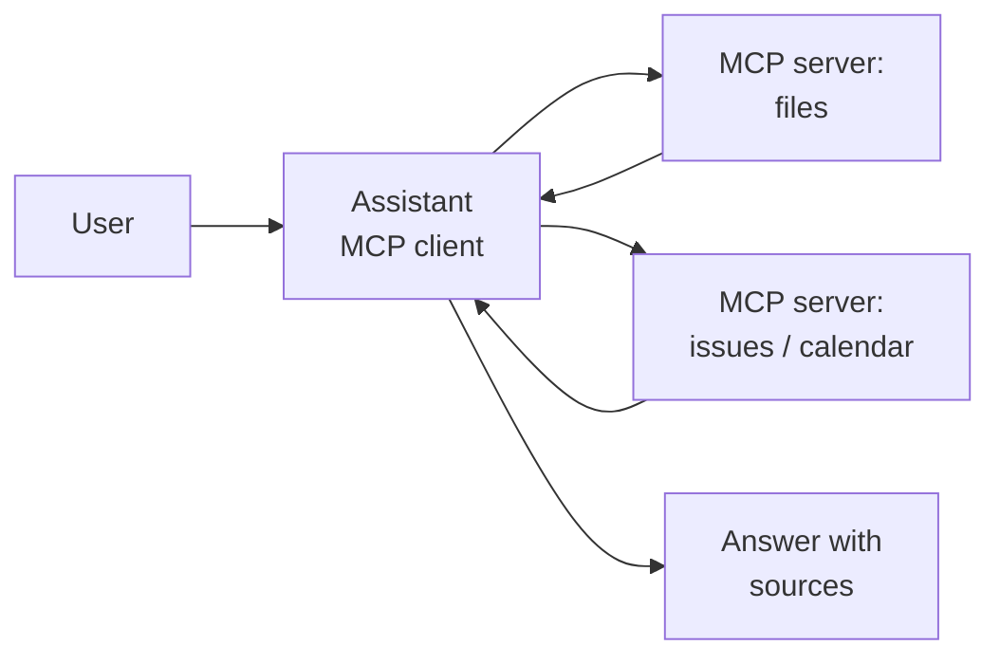
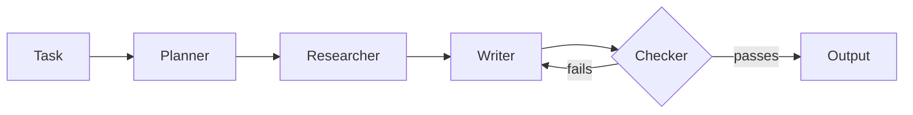
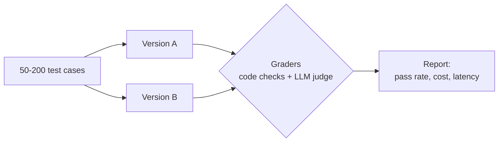
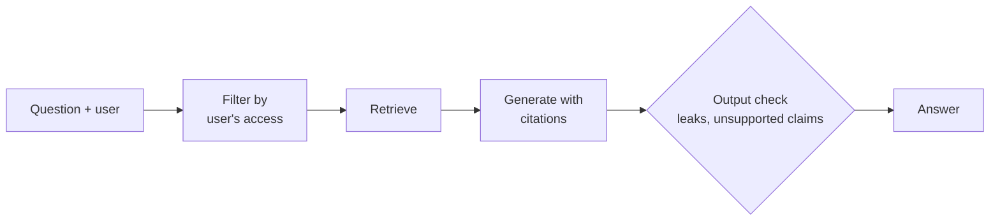
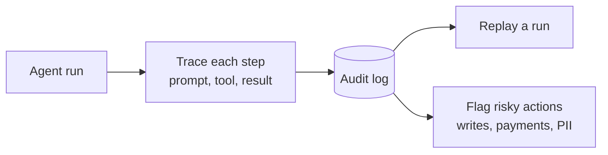
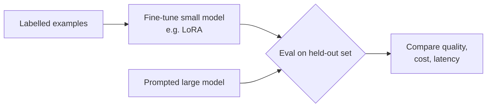
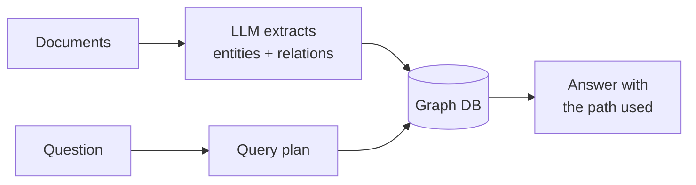

# 7 AI projects that get you interviews

*Last reviewed: October 2026*

Hiring teams for AI engineer, applied AI and forward deployed roles want to
see that you have built, measured and secured a real system, not that you
finished a tutorial. Each project below is small enough for a few weekends
and maps to a question you will be asked.

**How to make a project count**

- **Use real data** you're allowed to use: public docs, your own notes, an
  open dataset. Not a toy example.
- **Measure it.** Every project ships with a small eval set and a number
  ("answers grounded in a source: 46 of 50").
- **Write one page:** the problem, the design, one trade-off you made and
  why, and what you'd do next. That page is your interview answer.
- **Keep it honest.** Say what you built and what a library did for you.

## 1. MCP assistant

Build an assistant that uses tools through the
[Model Context Protocol](../../GenAI-Topics/mcp/index.md): for example,
answering questions about your own files and calendar, or a GitHub repo.

- **Build:** one MCP server you write yourself (two or three tools with
  strict schemas) plus an existing one; a client that picks tools.
- **Proves:** tool design, permissions, handling tool errors.
- **Stretch:** read-only by default; ask for confirmation before any write.
- **Interview:** *"Why MCP instead of calling the APIs directly?"*

## 2. Agent orchestration

A multi-step workflow with a planner and specialist steps, for example
"research a company, draft an outreach email, check it against rules."

- **Build:** a graph with state ([LangGraph](../../GenAI-Topics/langgraph/index.md)
  or plain code), a step limit, and a human approval step.
- **Proves:** control flow, state, when one agent is enough.
- **Stretch:** compare it with a single agent on the same 20 tasks: cost,
  time, success rate.
- **Interview:** *"When is multi-agent worth it?"*

## 3. AI evaluation harness

A test bench for any LLM feature: a dataset, graders, and a report that
compares two versions.

- **Build:** code graders where possible, an LLM judge with a rubric, and
  a check of the judge against 30 labels you made by hand.
- **Proves:** the skill most teams lack; see
  [Observability & Eval](../../GenAI-Topics/observability/index.md).
- **Stretch:** run it in CI so a prompt change can't merge if scores drop.
- **Interview:** *"How do you know your change made it better?"*

## 4. Secure RAG

Question answering over documents where each user sees only what they're
allowed to see, and injected instructions in documents don't work.

- **Build:** documents with access labels, retrieval filtered by the
  user's groups, citations on every answer, a test set of injection
  attempts.
- **Proves:** [RAG](../../GenAI-Topics/rag/index.md) plus security thinking,
  which enterprises care about most.
- **Stretch:** show the eval: injection attempts blocked, leaks found.
- **Interview:** *"How do you stop one customer seeing another's data?"*

## 5. Agent auditing

A log and review tool for an agent: every step, tool call and decision
recorded, with a view to replay a run and flag risky actions.

- **Build:** structured traces (OpenTelemetry-style spans), a simple UI or
  report per run, rules that flag actions needing review.
- **Proves:** observability and governance for agents in production.
- **Stretch:** tie flags back into guardrails, so the same action is
  blocked next time.
- **Interview:** *"An agent did something it shouldn't have. How do you
  find out why?"*

## 6. LLM fine-tuning

Fine-tune a small open model for one narrow task (classifying support
tickets, extracting fields) and compare it with prompting a larger model.

- **Build:** a clean dataset with a held-out test split, a parameter-
  efficient fine-tune, and the comparison table.
- **Proves:** you know *when* fine-tuning is worth it; see
  [AI economics](../../GenAI-Topics/ai-economics/index.md).
- **Stretch:** serve it behind an API and measure cost per 1,000 requests.
- **Interview:** *"Fine-tune or prompt? Defend your choice with numbers."*

## 7. Knowledge graph

Extract entities and relationships from documents into a graph, and answer
questions that need connections ("which projects used vendor X and failed
review?").

- **Build:** a schema you design first, extraction with validation, graph
  queries, and a comparison with plain vector RAG on the same questions.
- **Proves:** [Graph DB](../../GenAI-Topics/graph-db/index.md) skills and
  knowing when a graph beats vectors.
- **Stretch:** combine both (graph for relations, vectors for text).
- **Interview:** *"When would you use a knowledge graph instead of RAG?"*

## Which one first?

| Target role | Start with | Then |
|---|---|---|
| AI engineer | 3. Evaluation harness | 4. Secure RAG |
| Forward deployed engineer | 4. Secure RAG | 1. MCP assistant |
| Agent / platform engineer | 2. Orchestration | 5. Auditing |
| ML engineer | 6. Fine-tuning | 3. Evaluation harness |
| Data / knowledge engineer | 7. Knowledge graph | 4. Secure RAG |

Once a project is done, add it to your stories in the
[OfferReady app](https://getofferready.app/stories) and practise explaining
the trade-off out loud. That is what the interview tests.
